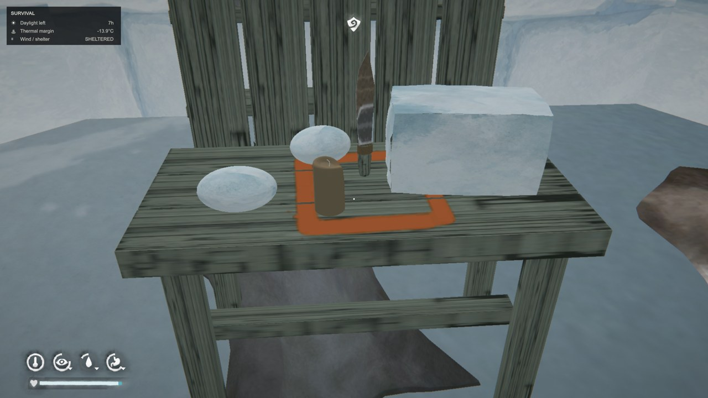

# Burebista Snow Blocks

**v0.1.4 · The Long Dark · Español / English**

[Descargar / Download](https://github.com/florynstefanache-source/BurebistaSnowBlocks/releases/latest) · [English](#english)

Captura de Burebista: bloques, nieve suelta y herramienta. El mobiliario y la vela pertenecen a otros mods. / Burebista's screenshot showing blocks, loose snow and the tool. Furniture and candle belong to other mods.

## Español

Un nuevo sistema para obtener agua a partir de **nieve que recoges como objetos reales de inventario**. Sustituye el derretido de nieve ilimitada del juego: primero debes recoger nieve o cortar bloques. También permite recoger agua contaminada en agujeros de pesca de agua dulce y utiliza bloques para construir el iglú compatible.

### Recoger nieve al empezar una partida

No necesitas un cuchillo para conseguir agua:

1. Sal al exterior y guarda el objeto que lleves en las manos.
2. Apunta a nieve del terreno cercana, a menos de 2,5 metros, sobre una superficie suficientemente llana.
3. Pulsa **E**.
4. Sin un Pana utilizable en la mochila, recoges con las manos **un montón de nieve de 0,5 litros**, que aparece en tu inventario.

Se muestra una animación de recoger nieve con ambas manos. **Esc** cancela. La nieve suelta sirve para agua, pero no para construir el iglú.

### Cuchillo Pana y bloques de 5 litros

Fabrica el **Pana — cuchillo de nieve** en un banco de trabajo con luz:

- 2 trozos de metal.
- 1 madera recuperada.
- 1 tripa curada.
- Herramientas simples, las normales; no necesitas herramientas de calidad.
- Tiempo: **60 minutos**.

Con el Pana utilizable en la mochila y las manos vacías, apunta a nieve exterior y pulsa **E**. En lugar de nieve suelta, cortas un **bloque de 5 litros**. El cuchillo pierde un 0,3 % de condición por bloque completado.

**Incluye animación en primera persona de extracción del bloque:** la herramienta corta la nieve y después ambas manos levantan el bloque para recogerlo. No es solo una barra de progreso. Esc cancela la acción; una acción cancelada no entrega el bloque.

### Derretir y hervir

1. Lleva nieve recogida en la mochila.
2. Pon una lata u olla compatible y libre sobre un fuego encendido.
3. Abre el menú de agua habitual y selecciona cuánto quieres derretir, dentro de la capacidad del recipiente y la nieve disponible.
4. La nieve pasa de la mochila al recipiente cuando empieza el derretido. **Hierve el agua para hacerla potable.**

El menú normal se conserva, pero **ya no genera nieve gratis**. Si no tienes nieve suficiente, el mod impide empezar. El agua contaminada que ya tengas sigue pudiéndose hervir: no necesitas recoger nieve adicional para hervirla.

### Consumo parcial: un bloque dura hasta agotarse

Un bloque entero equivale a **5 L** y un montón entero a **0,5 L**. Solo se consume la cantidad transferida al recipiente. El porcentaje indica la nieve que queda, no una pérdida de calidad del agua.

Ejemplo: derrites **2 L de un bloque de 5 L**. Conservas el mismo bloque con **3 L, al 60 %**. Al usar otros 2 L quedan **1 L, al 20 %**. Se prioriza la nieve parcialmente consumida; cuando un objeto llega a cero, desaparece. La cantidad restante se conserva al guardar y cargar.

Los bloques enteros aparecen **agrupados en una casilla con su número**; los montones enteros se agrupan por separado. Los objetos empezados quedan aparte, mostrando sus litros restantes. Esto también mantiene ordenada la vista de los contenedores.

### Recoger agua contaminada de un agujero de pesca

Abre y limpia completamente un agujero de **agua dulce**. En su menú de pesca aparece la opción de recoger agua. No se permite mientras el agujero esté congelado o se esté pescando, ni en agujeros identificados como agua salada.

Necesitas recipientes utilizables en la mochila:

| Recipiente | Capacidad reconocida |
| --- | --- |
| Olla | 2 L |
| Sartén | 1 L |
| Recipiente pequeño compatible, lata o cazuela | 0,5 L |

La capacidad libre es la **suma de los recipientes disponibles menos toda el agua contaminada de la mochila**. Los recipientes que estén cocinando no cuentan. Cada recogida está limitada por el recipiente de mayor capacidad y por el espacio libre total.

**Ejemplo: si solo llevas una olla de 2 L, puedes recoger hasta 2 L de agua contaminada. No puedes seguir recogiendo hasta hervirla o disponer de más capacidad.** Si ya llevas 1 L contaminado, esa olla permite recoger solo 1 L adicional. El agua potable no ocupa este cupo de agua contaminada; hervirla vuelve a dejar capacidad libre. Sin recipiente disponible no puedes recoger más agua del agujero.

### Construir el iglú con nieve

Con el mod de iglú compatible instalado, los requisitos son **40 bloques enteros de nieve + 1 piel curada de ciervo para la puerta**. Ya no se usan palos ni telas para esta construcción.

Los bloques pueden estar en la mochila o en el suelo a un máximo de **8 metros**. Los montones de 0,5 L y los bloques empezados **no cuentan** para construir. La piel debe estar en la mochila.

Se mantienen **F8 para construir y F5/F6 para la escala**, así como los muebles y addons. Snow Blocks no incluye el iglú: requiere tu instalación compatible de IgluAddon/BurebistaFishingShelter para esta integración. Los bloques y el sistema de agua funcionan sin él.

### Instalación e idioma

1. Instala **MelonLoader** y cierra The Long Dark.
2. Descarga `BurebistaSnowBlocks-v0.1.4-ES-EN.zip` desde Releases.
3. Copia `Mods/BurebistaSnowBlocks.dll` a la carpeta `Mods` del juego, sustituyendo la versión anterior. Guarda las copias antiguas fuera de `Mods`.
4. No instales el antiguo `BurebistaLanguages.dll`: esta versión no lo necesita.
5. Abre el juego. Los objetos, recetas, mensajes y ayudas de este mod siguen el idioma seleccionado: español o inglés.

Los modelos están integrados en la DLL. Para recoger nieve, espera unos segundos después de cargar la región, mantén las manos vacías y apunta a nieve exterior del terreno, no a muebles ni objetos. El ZIP automático del repositorio no es el paquete de instalación.

## English

A new water system based on **snow collected as actual inventory items**. It replaces unlimited free snow melting: gather snow or cut blocks before melting it. You can also collect unsafe water from freshwater fishing holes and use full blocks to build a compatible igloo.

### Start a new game without the tool

Go outdoors, put away the item in your hands, aim at nearby snow-covered terrain within **2.5 metres** on a sufficiently level surface, and press **E**. Without a usable Pana in your backpack, you gather a **0.5 L snow pile by hand**, with a two-handed gathering animation. It becomes an inventory item. **Esc** cancels. Loose snow can be melted but cannot build the igloo.

### Pana snow knife and 5 L blocks

Craft the **Pana snow knife** at a workbench with light: **2 scrap metal, 1 reclaimed wood, 1 cured gut and simple tools; 60 minutes**. Quality tools are not required.

Carry a usable Pana, keep your hands empty, aim at outdoor snow and press **E**. You cut a **5 L snow block** instead of collecting loose snow. Each completed block wears the knife by 0.3%.

**Includes a first-person block extraction animation:** the knife cuts through the snow, then both hands lift the block to collect it. It is not only a progress bar. Esc cancels; cancelled actions do not grant a block.

### Melting and boiling

Carry collected snow, place an empty compatible can or pot on a lit fire, and use the normal water menu. Select an amount within the vessel capacity and your available snow. Snow transfers from inventory when melting starts. **Boil the resulting water to make it safe.**

The familiar menu remains, but **it no longer creates free snow**. Insufficient snow prevents melting from starting. Unsafe water already in your inventory can still be boiled; boiling it does not require extra snow.

### Partial use and inventory grouping

Full blocks contain **5 L**, full piles **0.5 L**. Only the transferred amount is consumed. The condition percentage represents remaining snow.

Example: melt **2 L from a 5 L block**, leaving **3 L at 60%**. Melt another 2 L, leaving **1 L at 20%**. Partly used snow is prioritized and kept until empty. Empty items disappear; remaining amounts persist through saving and loading.

Full blocks share **one inventory entry with a count**. Full loose piles form their own group. Partly used items remain separate and show the remaining litres. Container displays are grouped too.

### Unsafe freshwater collection

Fully open and clear a **freshwater fishing hole**. Its fishing menu offers water collection. Frozen holes, active fishing and identified saltwater holes are excluded.

Carry usable vessels: **pot 2 L, skillet 1 L, compatible small vessel/can 0.5 L**. Vessels currently cooking do not count. Free capacity is the sum of eligible vessel capacities **minus all unsafe water already in your backpack**. Each collection is limited by the largest vessel and total free capacity.

**One 2 L pot allows a maximum of 2 L of unsafe water. You cannot collect more until you boil it or have more available capacity.** If you already carry 1 L unsafe, only 1 L remains free. Safe water does not occupy this unsafe-water allowance; boiling frees capacity again. Without an available vessel, collection is unavailable.

### Igloo construction

With the compatible igloo mod installed, construction requires **40 full snow blocks + 1 cured deer hide for the door**, replacing sticks and cloth. Blocks can be in your backpack or on the ground within **8 metres**; the hide must be in your backpack. Partly used blocks and 0.5 L piles do not count.

**F8 construction and F5/F6 scaling remain unchanged**, as do furniture and addons. The igloo itself is not included; this integration requires your compatible IgluAddon/BurebistaFishingShelter installation. Snow collection and water features work without it.

### Installation and language

1. Install **MelonLoader**, then close The Long Dark.
2. Download `BurebistaSnowBlocks-v0.1.4-ES-EN.zip` from Releases.
3. Copy `Mods/BurebistaSnowBlocks.dll` into the game's `Mods` folder, replacing the previous version. Keep backups outside `Mods`.
4. The old `BurebistaLanguages.dll` is not needed and should not be installed.
5. Launch the game. Items, recipes, messages and hints follow the selected game language: Spanish or English.

Models are embedded in the DLL. After loading, allow a few seconds before gathering. Keep hands empty and aim at outdoor terrain snow rather than furniture or gear. GitHub's automatic repository ZIP is not the installation package.

## Versión / Version 0.1.4

Traducción español/inglés conservando el sistema y sus controles. Compilación y 187 comprobaciones del sistema, más comprobaciones adicionales de idioma, superadas. Funcionamiento confirmado por Burebista en su partida.

Spanish/English localization preserving gameplay and controls. Build, 187 system checks and additional language checks passed. Burebista confirmed it working in their game.

## Créditos / Credits

Mod y captura: Burebista. The Long Dark pertenece a Hinterland Studio. Mod de aficionados no oficial. / Mod and screenshot: Burebista. The Long Dark belongs to Hinterland Studio. Unofficial fan mod.